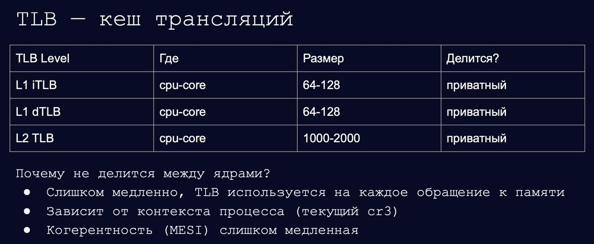

# CPU & Kernel

# Что значит запустить программу
- в конечном итоге это значит, что процессор будет выполнять инструкции программы, одна за другой, и делать это очень быстро

3 уровня защиты:
- время: кто силой отнимает CPU
- привилегии: кто может управлять железом
- память: кто куда имеет право писать


# Program & Process & Kernel

## Program - это файл на диске, набор байтов:
  .text
  .data
  .rodata
  symbols
  machine code

## Process - это запущенный экземпляр программы

У процесса есть:
- текущие значения регистров
- virtual address space
- stack
- heap
- открытые file descriptors
- состояние исполнения
- права доступа
- связь с kernel structures

## Kernel - это привилегированная часть ОС

Оно контролирует:
- CPU time
- physical memory
- page tables
- devices
- disks
- network
- times
- process table
- file descriptors
- interrupts
- syscall entry points

Ядро (kernel) контролирует CPU time через аппаратный таймер прерываний. Каждые N миллисекунд происходит аппаратное прерывание - ядро просыпается и решает кому дальше дать cpu time. Грубо говоря, OS планировщик (scheduler) подменяет rip (instruction pointer) регистр и загружает состояние регистров для текущей программы, где остановились в прошлий раз
Есть 2 типа привилегий: kernel-space (драйверы и само ядро) и user-space

- Вводится концепция виртуальной памяти - каждый процесс видит только свой кусочек памяти (виртуальной памяти) и не видит физическую память ядра

Kernel - это часть ПО, которая работает с полными машинными привилегиями. Ядро имеет полный контроль над ресурсами компьютера

Ядро является центральностью частью ОС

ОС шире ядра: кроме привилегированного ядра, она включается непривилегированные программы и библиотеки, которые взаимодействуют с ядром и делают машину удобнее для использования


Задачи ядра:
1) Справедливо и безопасно разделять машинные ресурсы между процессами
2) Давать безопасный и удобный доступ к машинным ресурсам через абстрации, например, через файлы как абстрацию диска
3) Обеспечивать robustness и performance, то есть устойчивость и производительность

Когда программа выполняется, ядро не эмулирует процессор для каждой инструкции, потому что это было бы очень медленно
Процессор также не спрашивает ядро перед каждой инструкцией, можно ли её выполнить. Вместо этого процессор напрямую исполняет большинство инстуркций процесса


## Processor time as resource
CPU time - это доля времени, в течение которого процессор выполняет инструкции одного процесса, а не другого. Ядро пытается распределять это время согласно своей политике (настройками планировщика)

## Timer interrupts
- Железо должно уметь прерывать процесс и передавать управление ядру
Для этого используется отдельное аппаратное устройство - timer
Ядро может настроить timer так, чтобы он срабатывал периодически в реальном времени, например, раз в миллисекунду.
Когда timer срабатывает, он посылает interrupt процессору. Это дает процессору шанс выполнить код ядра
При этом процессы не должны иметь права настраивать таймер
Ядро должно иметь право настраивать timer, потому что именно ОС выбирает политику распределения CPU time
Процессор должен поддерживать разные режимы привилегий, чтобы отличать привилегированный код от непривилегированного
Timer interrupt может произойти в любой момент выполнения процесса. Это не ошибка процесса. Поэтому после обработки interrupt процесс должен иметь возможность продолжить работу ровного с того места, где был остановлен, со всеми регистрами в прежнем состоянии.

Современные ОС используют режим Tickless - это значит, что таймер не "тикает" впустую, когда компьютер бездействует; Вместо этого ядро ОС высчитывает, когда должно произойти ближайшее событие (например, запуск потока или сетевой пакет), и программирует аппаратный таймер ровно на это время

В MacOS применяется агрессивное "размытие" таймеров - принудительно объединяет близкие тики в один интервал; Вместо друх прерываний (пример, через 10 мс и через 11 мс) процессор Apple Silicon получит только одно

## Current privilege level
- Текущий уровень привилегий хранится (x86-64) в младших двух битах регистра %cs
Некоторые инструкции можно выполнять только если CPL показывает, что текущий код имеет полный контроль над машиной
На x86-64 current privilege level - это число от 0 до 3, хранящееся в младших двух битах регистра %cs.

ring values (privilege level):
- значение 0 - kernel, полный machine privilege
- 1-2 - unprivileged, обычно не используется
- 3 - user, непривилегированный режим

При попытке вызова asm инструкции
```asm
movw $0, %cs
```
на процессоре сработает **General Protection Fault**, процессор перехватит управление и передаст исполнение в kernel, который в свою очередь аварийно завершит программу (segfault)
Есть только один способ поднять привилегии - запустить **Protected Control Transfer** - это происходит через системный вызовы

syscall - это ключевой интерфейс, через который user-space process взаимодействует с kernel. syscall нельзя подделать (если мы не разработчики ядра). В момент запуска ОС Syscall прописываются в специальную таблицу syscall'ов, зашитую в процессор

У процессов полностью отсутствует доступ к адресам ядра

Global offset table (GOT) - это offset для вызова системных вызовов - printf - syscall 1


## Virtual memory
Processor time, registers и primary memory - фундаментальные ресурсы компьютера.
- Primary Memory - RAM (Random access memory)

P: VA -> PA + (или) Fault

На машине может быть много mapping functions - P0 .. PN , но активна только одна. Разные функции могут переводить одинаковые virtual addresses в разные physical addresses. Поэтому разные процессы могут быть изолированы
Текущая mapping function задается специальным регистром. На x86-64 это %cr3 - это уникальный физический адрес

## Page tables
  Page tables - это структура данных, с помощью которой современные архитектуры реализуют virtual memory mapping function

  На x86-64 page table реализована как дерево с branching factor 512 и максимальной глубиной 4

Эту структуру создает и инициализирует ядро, но использует её процессор. Virtual memory system фактически использует page table при каждом memory access, чтобы вычислить физический адрес P(A) для виртуальной памяти A


2 ^ 48 максимальное значение оперативной памяти

на нижнем узле хранятся 4 кб (4096 байт и отдельно флаги)


Page walk - занимает от 4 до 5 последовательных запросов в память
В идеальном случае с L1, L2, L3 кэшами - Page Walk занимает от 10 до 35 тактов
В худшем случае, на холодную, Page Walk занимает ~500 наносекунд

В это время CPU просто простаивает (stalls) в ожидании данных

## Page fault

Запись в page table
PTE — Page Table Entry
Каждая запись (PTE) — 64 бита:
[ Physical Page Number (40 bits) | Flags (12 bits) ]
Флаги:
● P (Present) - Страница есть в RAM (0 → page fault)
● R/W - Можно ли писать
● U/S - User или Supervisor (kernel-only)
● NX - No-execute — запрет исполнения

## TLB - кэш трансляций

TLB (Translation Lookaside Buffer) - маленький кэш внутри CPU, хранящий последние трансляции virtual page -> physical address

Размер: 64-1024 записи
- Поиск меньше 1 такта
- TLB hit - трансляция мгновенная 0ns
- TLB miss - CPU делает page walk и сохраняет в TLB




## Page fault

Что если в PTE (Page Table Entry) флаг Present = 0?
1. Программа обращается к памяти
2. MMU читает PTE → Present = 0
3. MMU генерирует исключение #PF (Page Fault)
CPU прыгает в обработчик ядра.
Адрес, по которому был доступ — в регистре %cr2


Ядро смотрит: что это за адрес?
● Страница ещё не выделена (lazy) → Выделяет физ. страницу, ставит
Present=1
● Страница ушла в swap → Читает с диска, ставит обратно
● Copy-on-write (после fork) → Копирует страницу, делает writeable
● Адрес мусорный (вне валидных регионов) → SIGSEGV
● Программа писала в read-only → SIGSEGV

## Lazy allocation
```c
char *p = malloc(1024 * 1024 * 1024);   // 1 GB — это быстро?
p[0] = 'a';                             // а тут? (page fault)
p[4096] = 'b';                          // а тут? (новый PF)
```

Что происходит:
● malloc → syscall → ядро добавляет регион в VMA процесса,
физически ничего не выделяет
● Первое обращение → #PF → ядро только сейчас выделяет одну
страницу 4 KB
● Обращение к следующей странице → ещё #PF → ещё 4 KB


## fork() и copy-on-write (CoW)
fork() - создаёт точную копию процесса
Если у родителя 4 GB — должен скопировать 4 GB?
Copy-on-write:
● Ядро копирует только page tables (мегабайты, не гигабайты)
● Все PTE становятся read-only в обоих процессах
● Физические страницы остаются общими
Когда любой из процессов пишет в страницу:
● #PF (write на read-only)
● Ядро видит CoW → копирует физ. страницу → делает её writeable
● Только эта одна страница копируется


## swap
У меня 16 GB, но программы используют 20 GB?
Ядро вытесняет неактивные страницы на диск (swap partition / file):
● Выбирает холодную страницу (давно не использовалась)
● Записывает её содержимое на диск
● PTE становится Present=0, в нём пишется номер swap-слота

Когда программа обращается к этой странице:
● → #PF
● Ядро видит «это swap», читает с диска
● Записывает обратно в RAM, ставит Present=1
● Программа продолжает работу — только тормозила
Программа думает, что RAM безразмерный


## mmap (memory mapped) файлы
mmap - создаёт VMA, связанный с файлом. Физических страниц нет
```c
int fd = open("data.bin", O_RDONLY);
char *p = mmap(NULL, size, PROT_READ, MAP_PRIVATE, fd, 0);
printf("%c\n", p[12345]); // читает из файла
```

При обращении к p[12345]:
- → #PF
- Ядро видит это файл-mapping
- Читает нужную страницу из файла в RAM
- Маппит её в адрес → ставит Present=1
- Программа получает данные


## Итоги по виртуальной памяти
- MMU транслирует виртуальные адреса в физические через page tables
- CR3 указывает на корень page tables текущего процесса
- TLB кеширует трансляции для скорости
- Каждый процесс имеет своё виртуальное пространство (изоляция)
- Kernel space общий, но недоступен из ring 3
- Page fault — точка, где реализуется в коде:
  - Lazy allocation
  - Copy-on-write
  - Swap
  - File mapping
  - Защита памяти
